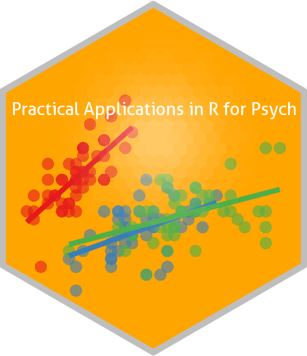

# Practical Applications in R for Psychologists

*Last updated 2026-03-30.*

This Github repo contains all lesson files for *Practical Applications
in R for Psychologists*. The goal is to impart students with the basic
tools to process data, describe data (w/ summary statistics and plots),
and the foundations of **building, evaluating and comparing statistical
models in `R`**, focusing on linear regression modeling (using both
frequentist and Bayesian approaches).

These topics were taught in the graduate-level course ***Advanced
Research Methods for Psychologists*** (Psych Dep., Ben-Gurion University
of the Negev), laying the foundation for the following topic-focused
courses:

- [Structural equation modelling
  (*SEM*)](https://github.com/mattansb/Structural-Equation-Modeling-foR-Psychologists)
- [Machine Learning
  (*ML*)](https://github.com/mattansb/Machine-Learning-foR-Psychologists)
- [Hierarchical linear models
  (*HLM*)](https://github.com/mattansb/Hierarchical-Linear-Models-foR-Psychologists)
- ~~[Analysis of Factorial Designs
  (*ANOVA*)](https://github.com/mattansb/Analysis-of-Factorial-Designs-foR-Psychologists)~~
  (no longer offered)

**Notes:**

- This repo contains only materials relating to *Practical Applications
  in R*. Though statistics are naturally discussed in many lessons, the
  focus is generally on the application and not on the theory.
- Please note that some code does not work *on purpose* and without
  warning, to force students to learn to debug.

## Setup

You will need:

1.  A fresh installation of [**`R`**](https://cran.r-project.org/)
    (preferably version 4.5.0 or above).
2.  [RStudio IDE](https://www.rstudio.com/products/rstudio/download/) or
    [Positron](https://positron.posit.co/download) (optional, but
    recommended).
3.  The following packages, listed by lesson:

| Lesson | Packages |
|:---|:---|
| [01 intro](01%20intro//) |  |
| [02 data wrangling](02%20data%20wrangling//) | `tidyverse`, `readxl`, `dplyr`, `datawizard`, `summarytools`, `psych`, `ggplot2`, `performance`, `see`, `finalfit`, `Hmisc`, `mice` |
| [03 plotting](03%20plotting//) | `dplyr`, `tidyr`, `ggplot2`, `ragg` |
| [04 NHST hypothesis testing and power](04%20NHST%20hypothesis%20testing%20and%20power//) | `tidyverse`, `effectsize`, `correlation`, `TOSTER`, `parameters`, `datawizard`, `pwr`, `ggplot2` |
| [05 Bayesian](05%20Bayesian//) | `effectsize`, `correlation`, `BayesFactor`, `bayestestR`, `see` |
| [06 regression basics](06%20regression%20basics//) | `ggplot2`, `effectsize`, `parameters`, `performance`, `marginaleffects` |
| [07 categorical predictors and model comparison](07%20categorical%20predictors%20and%20model%20comparison//) | `tidyverse`, `parameters`, `marginaleffects`, `datawizard`, `tidyverse`, `parameters`, `performance`, `bayestestR` |
| [08 moderation and curvilinear](08%20moderation%20and%20curvilinear//) | `dplyr`, `ggplot2`, `datawizard`, `parameters`, `performance`, `bayestestR`, `marginaleffects`, `modelbased` |
| [09 assumption checks and violations](09%20assumption%20checks%20and%20violations//) | `ggeffects`, `performance`, `see`, `parameters`, `qqplotr`, `datawizard`, `permuco`, `insight` |
| [10 ANOVA](10%20ANOVA//) | `afex`, `effectsize`, `tidyr`, `emmeans`, `ggbeeswarm`, `marginaleffects` |
| [11 generalized linear models](11%20generalized%20linear%20models//) | `dplyr`, `ggplot2`, `parameters`, `performance`, `marginaleffects`, `effectsize` |

<i>Installing R Packages</i>

You can install all the R packages used by running:

    # in alphabetical order:

    pak::pak(
      c(

        "cran::BayesFactor", # 0.9.12-4.8
        "cran::Hmisc", # 5.2-5
        "cran::TOSTER", # 0.8.6
        "cran::afex", # 1.5-1
        "cran::easystats", # 0.7.5
        "cran::emmeans", # 2.0.2
        "cran::finalfit", # 1.1.0
        "cran::ggbeeswarm", # 0.7.3
        "cran::ggeffects", # 2.3.2
        "cran::marginaleffects", # 0.32.0
        "cran::mice", # 3.19.0
        "cran::permuco", # 1.1.3
        "cran::psych", # 2.6.1
        "cran::pwr", # 1.3-0
        "cran::qqplotr", # 0.0.7
        "cran::summarytools", # 1.1.5
        "cran::tidyverse" # 2.0.0

      )
    )

------------------------------------------------------------------------

### Acknowledgements

Materials developed with Kim Rubinstein and Lihi Nagar.
